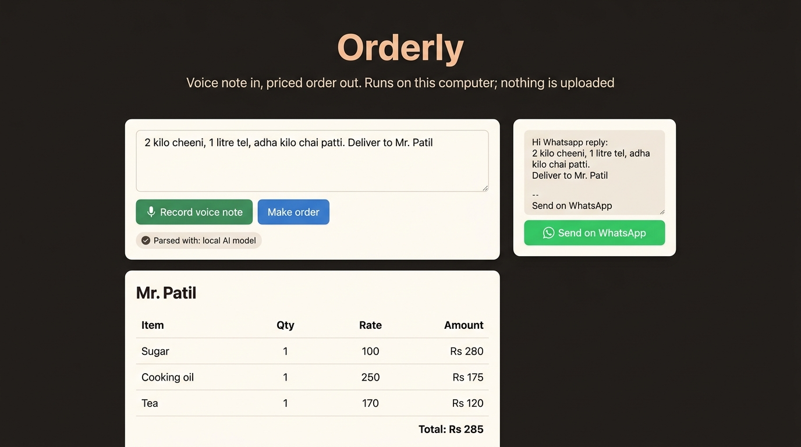

# Orderly

Turn a customer's voice note or message into a priced order, on your own computer. Built for small shops (kirana stores, tiffin services, tailors) whose orders arrive on WhatsApp in Hindi, Marathi or Hinglish.

```
voice note -> faster-whisper (open source, local) -> Gemma via Ollama (local)
           -> validator -> your catalogue.json prices -> invoice + WhatsApp reply
```

Nothing is uploaded anywhere. Customer names, addresses and order history stay on the shop's computer.



## Run

```bash
ollama pull gemma3:4b            # or gemma3:1b
pip install faster-whisper      # only needed for voice
python orderly.py               # open http://localhost:8000 (defaults to gemma3:4b)
python orderly.py --offline     # rule-based parser, no model needed
```

Edit `catalogue.json` with your items, prices, units and local-language aliases (for example "cheeni" for sugar).

## Design choices

- **The model reads, the code prices and checks.** The model only extracts items and quantities. Prices come from the shop's own catalogue, never from the model. Unknown items, unit mismatches and unreadable lines are shown as "Check these" instead of being guessed.
- **Falls back gracefully.** If Ollama is not running, a simple rule-based parser takes over and the page says so.
- **Standard library server**, one HTML page, no build step.

## Test and measure

```bash
pip install pytest && pytest -q
python eval.py --model gemma3:4b     # accuracy on eval/cases.jsonl
```

## Limits

Voice accuracy depends on the Whisper model and on accent and background noise. The offline parser only understands "quantity [unit] item" lists. Not tax or accounting advice.
